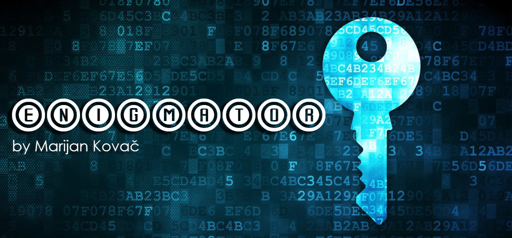

<a name="readme-top"></a>

<div align="right">
<a href="./README.en.md"></a>
</div>

<!-- INTRO -->
<br />
<div align="center">
  

  <h3 align="center">qEnigmator</h3>

  <p align="center">
    Program je nastao u sklopu projekta na temu "Kriptiranje, dekriptiranje, digitalni potpis" iz kolegija Operacijski sustavi 2.
    <br />
    <a href="https://nastava.foi.hr/course/93110"><strong>Saznajte više »</strong></a>
    <br />

  <a href="https://github.com/mkovac700/os2/issues">Report Bug 🪲</a>
  ·
  <a href="https://github.com/mkovac700/os2/issues">Request Feature 🚀</a>

  <a href="https://github.com/mkovac700/os2/stargazers"></a>
  <a href="https://github.com/mkovac700/os2/issues"></a>
  <a href=""></a>

  </p>
</div>

<!-- TABLE OF CONTENTS -->
<details>
  <summary>Sadržaj</summary>
  <ol>
    <li>
      <a href="#-o-projektu">O projektu</a>
      <ul>
        <li><a href="#općenito">Općenito</a></li>
        <li><a href="#opis-zadatka">Opis zadatka</a></li>
      </ul>
    </li>
    <li>
      <a href="#-glavne-značajke">Glavne značajke</a>
    </li>
    <li><a href="#-korišteni-alati">Korišteni alati</a></li>
    <li>
      <a href="#-konfiguracija">Konfiguracija</a>
      <ul>
        <li><a href="#preduvjeti">Preduvjeti</a></li>
        <li><a href="#podešavanje">Podešavanje</a></li>
      </ul>
    </li>
    <li><a href="#-preuzimanje">Preuzimanje</a></li>
    <li>
      <a href="#-doprinos">Doprinos</a>
      <ul>
        <li><a href="#-bugovi-i-prijedlozi">Bugovi i prijedlozi</a></li>
        <li><a href="#-dnevnik-promjena">Dnevnik promjena</a></li>
      </ul>
    </li>
    <li><a href="#-primjena">Primjena</a></li>
    <li><a href="#-licenca">Licenca</a></li>
  </ol>
</details>

<!-- ABOUT THE PROJECT -->
## 📖 O projektu

### Općenito

<table>
  <tbody>
    <tr>
      <td>👦🏽 Autor</td>
      <td>Marijan Kovač</td>
    </tr>
    <tr>
      <td>🧑🏽‍🏫 Mentori</td>
      <td>Prof dr. sc. Ivan Magdalenić <br> Dr. sc. Luka Milić</td>
    </tr>
    <tr>
      <td>🏛️ Ustanova</td>
      <td>Sveučilište u Zagrebu <br> Fakultet organizacije i informatike <br> Varaždin</td>
    </tr>
    <tr>
      <td>📆 Datum</td>
      <td>03. 12. 2022.</td>
    </tr>
  </tbody>
</table>

### Opis zadatka

Ostvariti program koji omogućuje stvaranje i pohranjivanje kriptografskih ključeva u datoteke, kriptiranje i/ili dekriptiranje zadane datoteke simetričnim i asimetričnim algoritmom, izračunavanje sažetka poruke (ulazne datoteke) te digitalno potpisivanje ulazne datoteke i provjeru digitalnog potpisa. <br>

Za simetrično i asimetrično kriptiranje te za izračunavanje sažetka poruke koristiti gotove, slobodno raspoložive izvorne tekstove programa po vlastitom izboru. Svaki korak mora biti spremljen u posebnu datoteku npr. kriptirani tekst, potpis i sažetak trebaju biti spremljeni u posebnu datoteku. Kod dekriptiranja teksta je potrebno učitati kriptirani tekst iz datoteke. Kod provjere digitalnog potpisa je potrebno ponovno učitati digitalni potpis iz datoteke i originalnu datoteku koja je bila potpisana. Kod provjere digitalnog potpisa se očekuje da se provjeri ispravnost digitalnog potpisa pri čemu do pogreške (promjene sadržaja) može doći u originalnoj datoteci ili u datoteci koja sadržava digitalni potpis. Zabranjena je uporaba nesigurnih algoritama DES i MD5.

<div align="center">
  
</div>

<p align="right">(<a href="#readme-top">povratak na vrh</a>)</p>

## ⚡ Glavne značajke

* stvaranje i pohranjivanje kriptografskih ključeva u datoteke `tajni_kljuc.txt`, `javni_kljuc.txt` i `privatni_kljuc.txt`

* kriptiranje, odnosno dekriptiranje zadane datoteke simetričnim i asimetričnim algoritmom

* izračunavanje sažetka poruke (ulazne datoteke)

* digitalno potpisivanje ulazne datoteke te provjeru digitalnog potpisa.


<p align="right">(<a href="#readme-top">povratak na vrh</a>)</p>

## ⛏️ Korišteni alati

<div align="center">
  
  

  <a href="https://www.chilkatsoft.com/"></a>
</div>

<p align="right">(<a href="#readme-top">povratak na vrh</a>)</p>

## ⚙️ Konfiguracija

<table>
  <tbody>
    <tr>
      <td>⚠️ Napomena: Program za rad koristi licencirani softver (Chilkat Software) s besplatnim probnim razdobljem od 30 dana. Nakon toga program neće raditi ispravno! Za više detalja kliknite <a href="https://github.com/mkovac700/os2/issues"><strong>ovdje</strong></a>.</td>
    </tr>
  </tbody>
</table>

### Preduvjeti

Da biste podesili projekt lokalno, trebat će vam slijedeće:

* Qt Framework

  * Preuzmite Qt na sljedećem <a href="https://www.qt.io/download-open-source"><strong>linku</strong></a>

  * Prilikom instalacije odaberite Desktop Development

* Chilkat Software

  * Preuzmite odgovarajuću verziju:
    * Windows - <a href="https://www.chilkatsoft.com/downloads_mingw.asp">MinGW-w64 10.&#42;.&#42; x86_64</a>
    * Linux - <a href="https://www.chilkatsoft.com/chilkatLinux.asp">Chilkat gcc C/C++ Libs for 64-bit Linux (x86_64)</a>
  
  * Izdvojite mapu na željeno odredište. Preporuke:
    * Windows - smjestiti u željenu mapu koja se nalazi u naddirektoriju projekta, npr:
    ```sh
    C:\Users\{username}\Documents\Libraries\chilkat-mingw-x86_64-10.0.0-posix-seh
    ```
    uz pretpostavku da se projekt nalazi u direktoriju Documents, npr:
    ```sh
    C:\Users\{username}\Documents\Projects\os2\qEnigmator
    ```
    * Linux - smjestiti u željenu mapu, npr:
    ```sh
    /home/{user}/chilkat-9.5.0-x86_64-linux-gcc/
    ```


### Podešavanje

* Klonirajte ovaj repozitorij
```sh
git clone https://github.com/mkovac700/os2.git
```
* U mapi `qEnigmator` pronađite i otvorite datoteku `qEnigmator.pro` (koristeći Qt Creator)

* Odaberite odgovarajuću konfiguraciju (development kit)

* Kliknite na `Configure Project`

* Otvorite datoteku `qEnigmator.pro` te kod `linux-g++*`, odnosno `win32` uvjeta prilagodite putanje do Chilkat biblioteke. <br><br>
⚠️ Napomena: Kod `win32` koristite relativne putanje u odnosu na projekt. To se postiže tako da se koristi `$$PWD` koji predstavlja korijenski direktorij projekta, a zatim se koristi `/../../` za "pomicanje" u naddirektorij gdje se nalazi biblioteka. <br><br>

* Sada možete istražiti programski kôd 🔎, pokrenuti ▶️, debugirati 🪲 ili buildati 🔨 projekt

<p align="right">(<a href="#readme-top">povratak na vrh</a>)</p>

## 📦 Preuzimanje

<table>
  <tbody>
    <tr>
      <td>⚠️ Napomena: Program za rad koristi licencirani softver (Chilkat Software) s besplatnim probnim razdobljem od 30 dana. To znači da u trenutnoj verziji većina funkcionalnosti više ne radi! Za više detalja kliknite <a href="https://github.com/mkovac700/os2/issues"><strong>ovdje</strong></a>.</td>
    </tr>
  </tbody>
</table>

Program je dostupan za Windows i Linux operacijski sustav. 

<div align="center">
<a href="https://github.com/mkovac700/os2/releases/"></a>
</div>

<p align="right">(<a href="#readme-top">povratak na vrh</a>)</p>

## 🌟 Doprinos

### Bugovi i prijedlozi

Za prijavu bugova 🪲 ili za nove prijedloge 🚀 kliknite  <a href="https://github.com/mkovac700/os2/issues"><strong>ovdje</strong></a>.

### Dnevnik promjena

Pregled povijesti promjena i verzija možete vidjeti u <a href="./CHANGELOG.md">`CHANGELOG.md`</a>

<p align="right">(<a href="#readme-top">povratak na vrh</a>)</p>

## 🚀 Primjena

Ovaj se program može koristiti u obrazovne svrhe. 

<p align="right">(<a href="#readme-top">povratak na vrh</a>)</p>

## 📜 Licenca

Ovaj je rad licenciran pod <a href="https://creativecommons.org/licenses/by-nc-sa/3.0/">CC BY-NC-SA 3.0</a>. Za više informacija pogledajte `LICENSE.txt`

<p align="right">(<a href="#readme-top">povratak na vrh</a>)</p>

[contributors-shield]: https://img.shields.io/github/contributors/mkovac700/os2?style=for-the-badge
[contributors-url]: https://github.com/othneildrew/Best-README-Template/graphs/contributors
[forks-shield]: https://img.shields.io/github/forks/mkovac700/os2?style=for-the-badge
[forks-url]: https://github.com/othneildrew/Best-README-Template/network/members
[stars-shield]: https://img.shields.io/github/stars/mkovac700/os2?style=for-the-badge
[stars-url]: https://github.com/othneildrew/Best-README-Template/stargazers
[issues-shield]: https://img.shields.io/github/issues/mkovac700/os2?style=for-the-badge
[issues-url]: https://github.com/othneildrew/Best-README-Template/issues
[license-shield]: https://img.shields.io/github/license/mkovac700/os2.svg?style=for-the-badge
[license-url]: https://github.com/othneildrew/Best-README-Template/blob/master/LICENSE.txt
